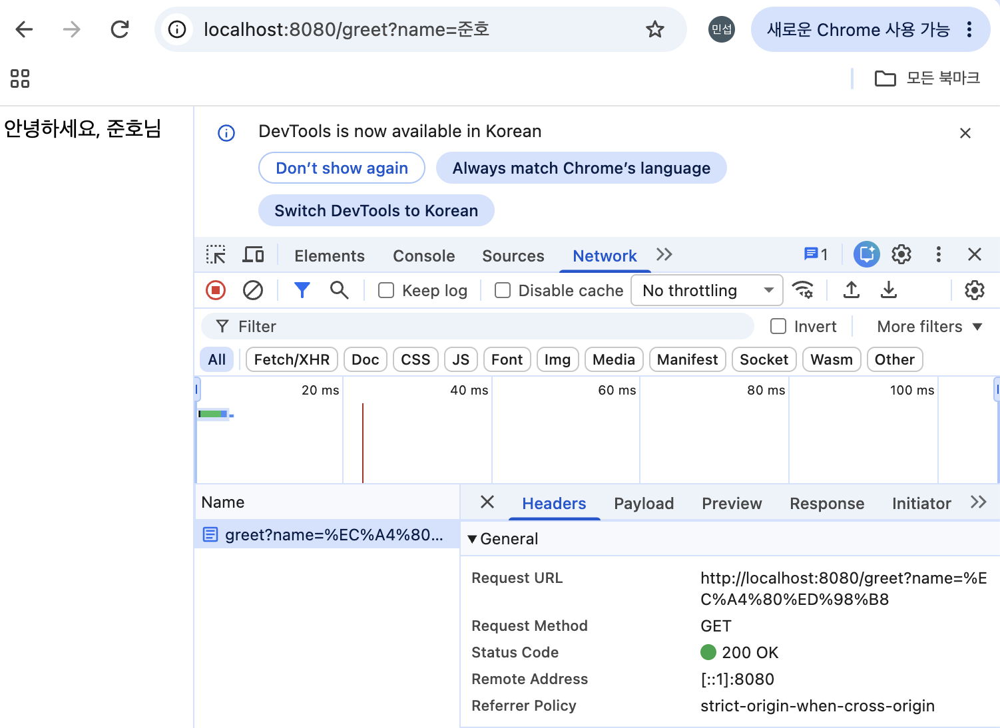
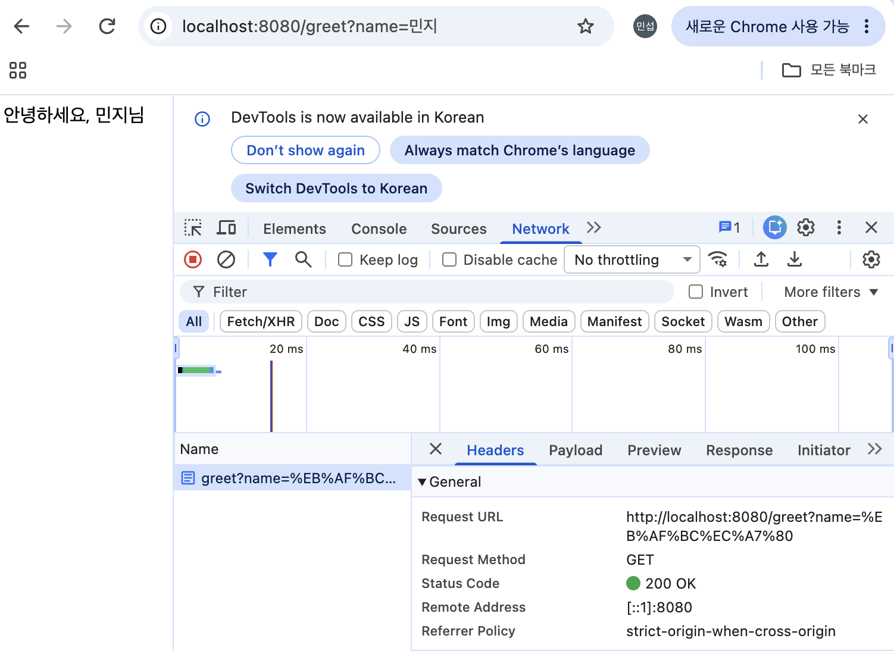
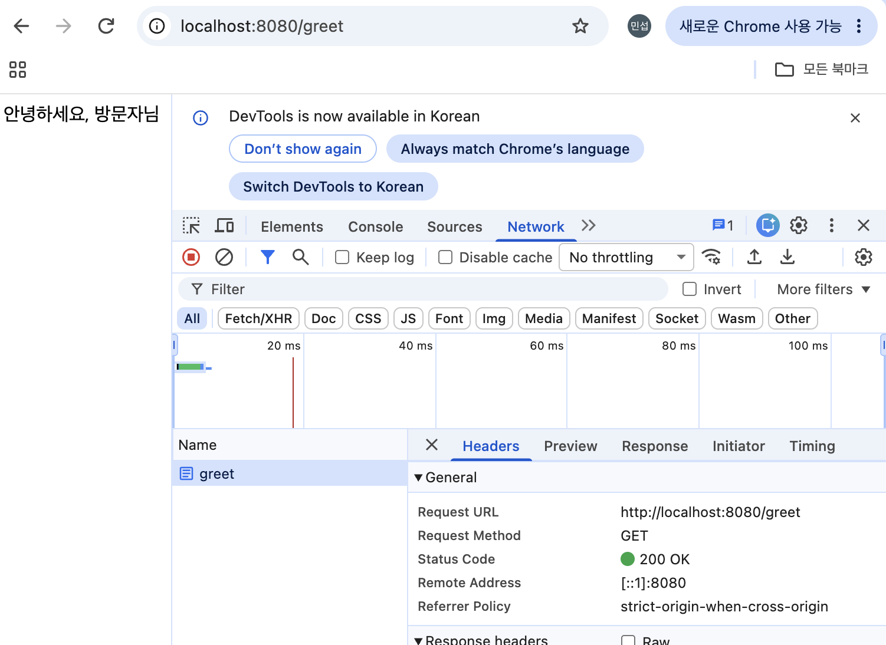
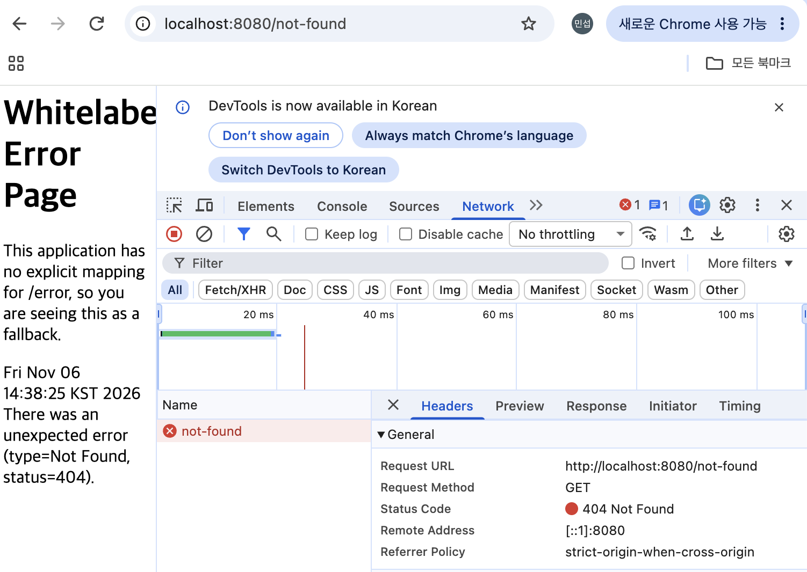

## greeting-api 소개
Spring Boot로 만든 인사말 서버입니다. 브라우저에서 URL로 요청하면 인사말 문자열을 응답합니다. `/hello`는 고정 문구를, `/greet`은 이름을 받아 `안녕하세요, {이름}님`을 돌려줍니다.

## 목표
- [x] 인사 API(`/hello`, `/greet`) 구현
- [x] Controller와 Service의 역할을 나누어 구현

## 코드 소개
**GreetingController**: 요청을 받는 역할입니다.
- `@RestController`: 반환값을 그대로 응답 본문으로 보냅니다.
- `@GetMapping("/greet")`: `GET /greet` 요청을 `greet` 메서드가 처리합니다.
- `@RequestParam(name = "name", defaultValue = "방문자")`: 쿼리 파라미터 `name`을 받고, 값이 없으면 "방문자"를 사용합니다.
- 생성자로 `GreetingService`를 주입받아(생성자 주입) 인사말 생성을 맡깁니다.

**GreetingService**: 인사말을 만드는 역할입니다.
- `@Service`: Spring이 관리하는 Bean으로 등록합니다.
- `greet(String name)`: `"안녕하세요, " + name + "님"` 문자열을 반환합니다.

요청 흐름: URL → GreetingController → GreetingService → 인사말 응답

## 확인 결과

### 1. `GET /hello`
- 상태: 200
- 응답 본문: `Hello, Spring!`

### 2. `GET /greet?name=민지`
- 상태: 200
- 응답 본문: `안녕하세요, 민지님`

### 3. `GET /greet` (name 없음)
- 상태: (확인 값)
- 응답 본문: (확인 값, 기대: `안녕하세요, 방문자님`)

### 4. `GET /not-found`
- 상태: (확인 값, 기대: 404)
- 응답 본문: (확인 값)

### 빌드 결과
`./gradlew build` → (실제 결과, 기대: BUILD SUCCESSFUL)

## 관련 PR
- 제출 후 PR 링크 추가