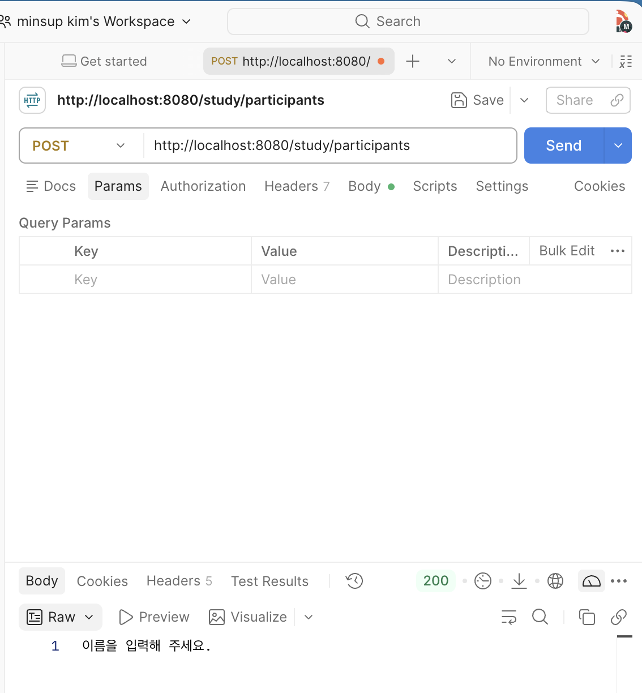
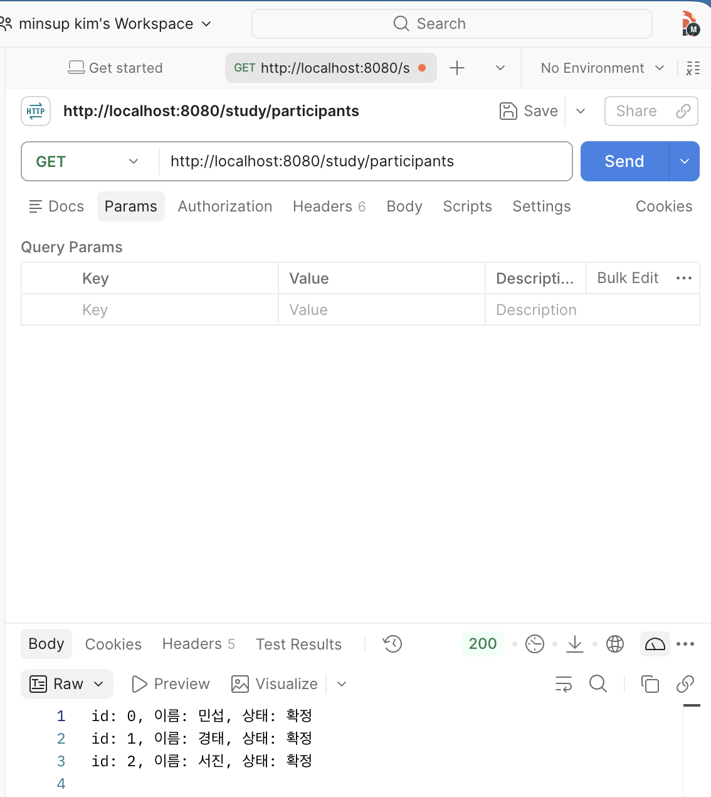
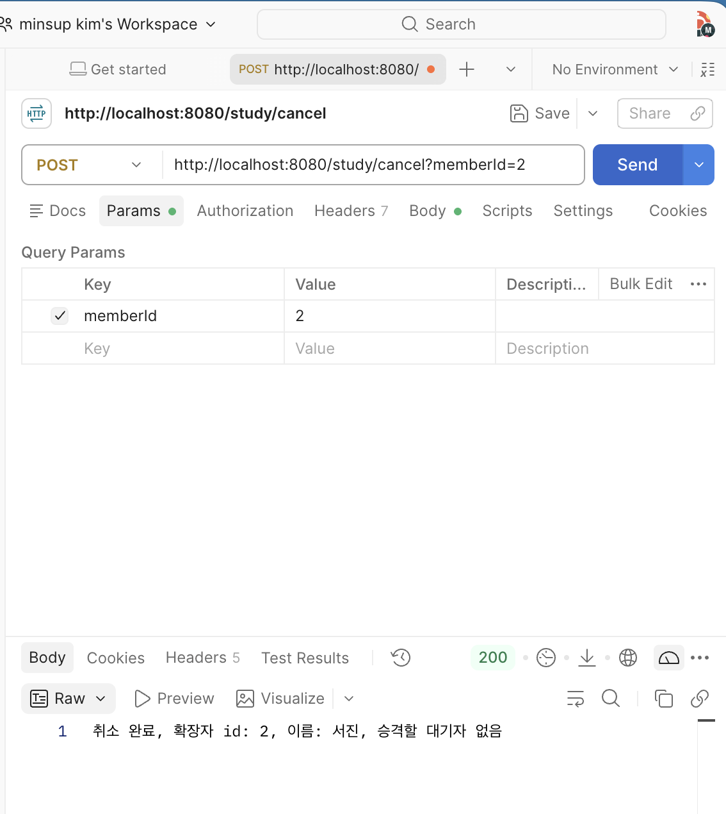
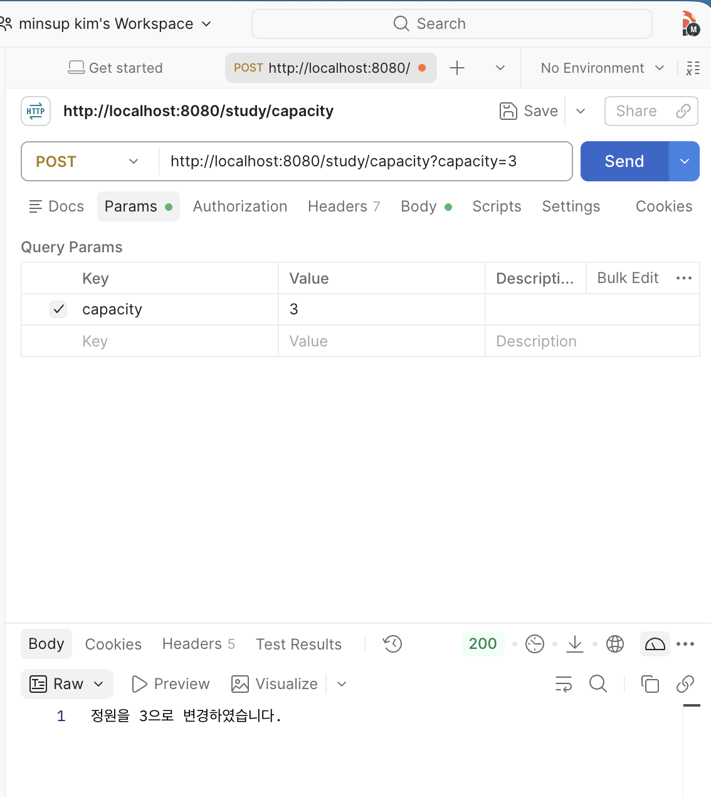

## study-api 소개
스터디 참가 신청을 관리하는 Spring Boot 서버입니다. 이름으로 신청하면 정원 안에서는 `확정`, 정원을 넘으면 `대기`가 됩니다. 참가자 조회, 신청 취소, 정원 변경 기능을 제공합니다. 데이터는 서버 메모리에 저장되므로 서버를 재시작하면 초기화됩니다.

## 목표
- [x] 참가 신청 API 구현 (확정/대기 구분, 빈 값·중복 이름 거절)
- [x] 참가자 조회 API 구현
- [x] 신청 취소 API 구현 (확정자 취소 시 대기자 승격)
- [x] 정원 변경 API 구현 (정원 증가 시 대기자 승격)

## API
| 기능 | 요청 | 파라미터 |
|---|---|---|
| 참가 신청 | `POST /study/participants` | `name` |
| 참가자 조회 | `GET /study/participants` | 없음 |
| 신청 취소 | `POST /study/cancel` | `memberId` (신청 시 받은 id) |
| 정원 변경 | `POST /study/capacity` | `capacity` (1~10) |

실행: `study-api/`에서 `./gradlew bootRun` → http://localhost:8080
(POST 요청은 브라우저 주소창으로 보낼 수 없어 Postman 또는 `study.html`로 확인합니다.)

## 코드 소개
**StudyController**: 요청을 받는 역할입니다.
- `@RestController`, `@RequestMapping("/study")`: `/study` 아래의 요청을 처리하고 반환값을 그대로 응답합니다.
- `@PostMapping`, `@GetMapping`: 기능별로 URL과 요청 방식을 연결합니다.
- `@RequestParam(required = false)`: 파라미터가 빠져도 오류 없이 메서드가 실행되게 해서, 빈 값 처리를 Service에서 직접 하도록 했습니다.
- 생성자로 `StudyService`를 주입받아 실제 처리를 맡깁니다.

**StudyService**: 신청과 취소, 정원 규칙을 처리하는 역할입니다.
- `@Service`: Spring이 관리하는 Bean으로 등록합니다.
- 참가자 목록(`List<Participant>`), 다음 id, 정원(`CAPCITY`, 기본 3)을 보관합니다.
- 목록을 바꾸는 `register`, `cancel`, `capacity`에는 `synchronized`를 붙여 동시에 요청이 와도 목록이 꼬이지 않게 했습니다.
- `Participant`는 id, 이름, 상태(`확정`/`대기`)를 가진 내부 클래스입니다.

요청 흐름: URL → StudyController → StudyService → 결과 문자열 응답

## 규칙
**신청 (`register`)**
- 이름이 없거나 공백뿐이면 `이름을 입력해 주세요.`로 거절합니다.
- 앞뒤 공백을 제거한 이름이 이미 있으면 `이미 신청하였습니다.`로 거절합니다.
- 현재 참가자 수가 정원보다 적으면 `확정`, 아니면 `대기`입니다.

**대기자 선택 규칙**
- 자리가 생기면 **목록에서 가장 앞에 있는 `대기` 참가자**를 `확정`으로 올립니다. 목록은 신청한 순서대로 쌓이므로 먼저 신청한 대기자가 먼저 승격됩니다.
- 확정자가 취소하면 대기자 1명이 승격되고, 대기자가 없으면 승격 없이 취소만 됩니다.
- 대기자가 취소하면 승격은 일어나지 않습니다.
- 정원을 늘리면 늘어난 자리 수만큼 대기자를 앞에서부터 승격합니다.

**취소 (`cancel`)**: id가 비었거나 숫자가 아니거나 없는 id이면 각각 거절 메시지를 반환합니다.

**정원 변경 (`capacity`)**: 비어 있음, 숫자 아님, 1~10 범위 밖, 현재 확정 인원보다 작음 중 하나면 변경하지 않고 현재 정원과 실패 이유를 반환합니다.

## 출력 형식
| 상황 | 응답 |
|---|---|
| 신청 성공 | `신청 완료 - id: {id}, 이름: {이름}, 상태: {확정/대기}` |
| 조회 | 참가자마다 한 줄: `id: {id}, 이름: {이름}, 상태: {상태}` (없으면 `참가자가 없습니다.`) |
| 대기자 취소 | `취소 완료, 대기자 id: {id}, 이름: {이름}` |
| 확정자 취소 | `취소 완료, 확정자 id: ..., 이름: ... / 승격 id: ..., 이름: ...` |
| 정원 변경 성공 | `정원을 {n}으로 변경하였습니다.` |
| 정원 변경 실패 | `현재 정원 수: {n}, 실패 이유: {이유}` |

## 확인 결과

### 1. 참가 신청 `POST /study/participants`
- 요청 URL: http://localhost:8080/study/participants
- 상태: 200

### 2. 참가자 조회 `GET /study/participants`
- 요청 URL: http://localhost:8080/study/participants
- 상태: 200

### 3. 신청 취소 `POST /study/cancel`
- 요청 URL: http://localhost:8080/study/cancel?memberId=2
- 상태: 200

### 4. 정원 변경 `POST /study/capacity`
- 요청 URL: http://localhost:8080/study/capacity?capacity=3
- 상태: 200

### 빌드 결과
`./gradlew build` → (실제 결과, 기대: BUILD SUCCESSFUL)

## 관련 PR
- 제출 후 PR 링크 추가