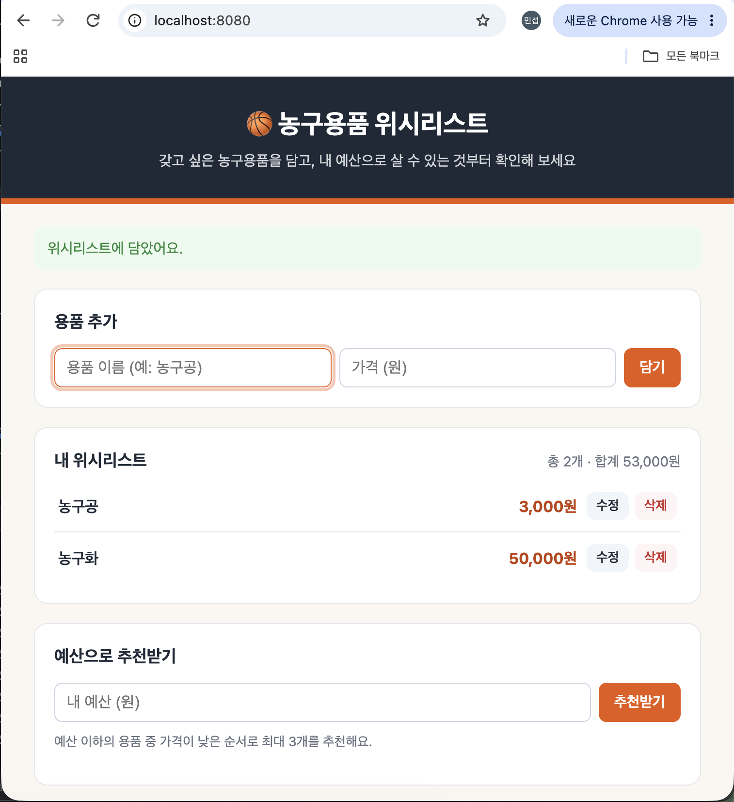

# 🏀 Basketball Wishlist

갖고 싶은 농구용품을 위시리스트에 담고, 내 예산 안에서 살 수 있는 용품을 추천받는 웹 서비스입니다.
백엔드는 Spring Boot REST API로, 화면은 HTML로 구현했습니다.

## 화면



- 농구용품 이름과 가격을 입력해 위시리스트에 등록
- 가격이 낮은 순으로 정렬된 목록 확인, 수정, 삭제
- 예산을 입력하면 살 수 있는 용품 최대 3개 추천

## 기능

- 용품 등록 / 전체 조회 / 단건 조회 / 수정 / 삭제
- 목록은 **가격 오름차순**으로 정렬되며, 같은 가격은 **등록 순서**를 유지합니다.
- 예산을 입력하면 예산 이하의 용품을 **최대 3개** 추천합니다. 살 수 있는 용품이 없으면 빈 목록을 반환합니다.

## API

| 기능 | 메서드 | URL | Body 예시 |
|---|---|---|---|
| 등록 | POST | `/wish` | `{"name":"농구공","price":35000}` |
| 전체 조회 | GET | `/wish` | - |
| 단건 조회 | GET | `/wish/{id}` | - |
| 수정 | PUT | `/wish/{id}` | `{"name":"농구화","price":129000}` |
| 삭제 | DELETE | `/wish/{id}` | - |
| 예산 추천 | GET | `/wish/recommend/{budget}` | - |

`id`는 서버가 자동으로 부여하며, 수정 시에는 URL의 id를 기준으로 합니다.

### 사용 예시

```
POST /wish   {"name":"농구공","price":35000}
POST /wish   {"name":"무릎보호대","price":18000}
POST /wish   {"name":"농구화","price":129000}
POST /wish   {"name":"헤어밴드","price":0}

GET /wish/recommend/40000
→ 헤어밴드(0원), 무릎보호대(18,000원), 농구공(35,000원)
```

## 입력 규칙

- 이름: null, 빈 문자열, 공백만 있는 값은 거부(400). 앞뒤 공백은 제거합니다.
- 가격: 0 이상의 정수. 0원은 허용하고, 음수나 null은 거부(400).
- 예산: 0 이상. 음수는 거부(400).
- 없는 id로 조회/수정/삭제하면 404.

## 실행과 테스트

```bash
./gradlew bootRun    # 서버 실행 후 http://localhost:8080 접속
./gradlew test       # 테스트 실행
```

## 상세 결과

Postman으로 각 API를 호출한 결과와 단위 테스트 실행 결과입니다.

### 1. 등록 (POST)

`POST /wish` — 용품을 등록하면 서버가 부여한 `id`와 함께 등록된 내용이 반환됩니다.


### 2. 전체 조회 (GET)

`GET /wish` — 가격 오름차순으로 정렬된 목록이 반환되고, 같은 가격은 등록 순서를 유지합니다.


### 3. 수정 (PUT)

`PUT /wish/{id}` — URL의 id 기준으로 이름과 가격이 수정되고, 수정 후 가격순으로 다시 정렬됩니다.


### 4. 예산 추천 (GET)

`GET /wish/recommend/{budget}` — 예산 이하의 용품을 가격이 낮은 순으로 최대 3개 반환합니다.


### 5. 단위 테스트

`ListWishRepositoryTest` 4개 테스트가 모두 통과했습니다.

- 정상 등록·목록·단건 조회
- 빈 이름·음수 가격·음수 예산 거부
- 가격 정렬·같은 가격의 순서·예산 경계·최대 3개
- 빈 결과·가격 0·조회 전후 원본 보존


## 프로젝트 구조

```
src/main
├─ java/com/example/wishlist/management
│   ├─ presentation     Controller, 예외 처리
│   ├─ application      Service, WishDto
│   ├─ domain           Wish, WishRepository
│   └─ intrastructure   ListWishRepository (메모리 저장소)
└─ resources/static     index.html (화면)
```

데이터는 메모리에 저장되므로 서버를 재시작하면 초기화됩니다.

## 기술 스택

- Java <버전>, Spring Boot <버전>, Gradle
- HTML, JavaScript (fetch API)
- JUnit 5, AssertJ
